# FlightBook

Personal EASA pilot logbook (AMC1 FCL.050) as an installable, offline-first PWA.
The Android phone is the master logbook; the same app in a desktop browser is a read-only viewer, fed by snapshots in your own Google Drive. No backend.

**Status:** complete and in use. Core flight logging (with aircraft photos), airports and automatic night time, totals, currency and class-rating revalidation, notification alerts, the map, export / import / PDF, and Google Drive backup with a read-only viewer. Drive needs a Google client ID before it does anything (see [docs/google-cloud-setup.md](docs/google-cloud-setup.md)); without one the app works fully offline and the Drive screens say so.

**The regulatory numbers are checked against the EASA text** — see [Totals and currency](#totals-and-currency) for what was checked, against which revision, and what the app still cannot know.

## Screenshots
Every screenshot shows an **invented** logbook: a fictional pilot, with flights, times, remarks and people that are made up. The airports and routes are real. Night time and the day/night take-offs and landings were calculated by the app itself, and the currency and rating states are the app's own, not mock-ups &mdash; the demo logbook is seeded so that SEP (land) has its revalidation experience met, MEP (land) has its proficiency-check window open, SET (land) has expired, a valid instrument rating makes night currency not required, and the medical is inside its 45-day revalidation window. **Flight, Totals, Map and Alerts are in dark mode and the map is on "Aviation magenta"**, so the theme setting and the map colour options are visible rather than just described; the rest are light.

They are all **reproducible**: `scripts/make-demo-logbook.ts` writes the logbook from a fixed seed, and `scripts/make-screenshots.mjs` drives a real build of the app in headless Chromium with the clock pinned to the demo's date, so re-running them gives the same images. See [Regenerating the screenshots](#regenerating-the-screenshots). The aircraft photos are real ones the app looked up on Wikimedia Commons, under free licences, credited [below](#photo-credits).

| Logbook | Flight | New flight |
|---|---|---|
| 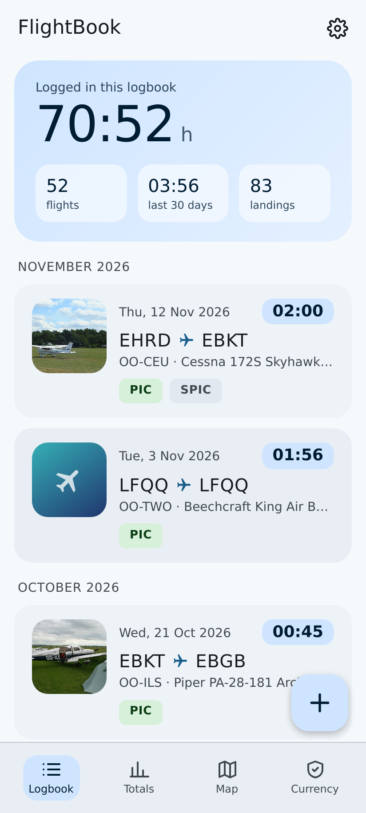 | 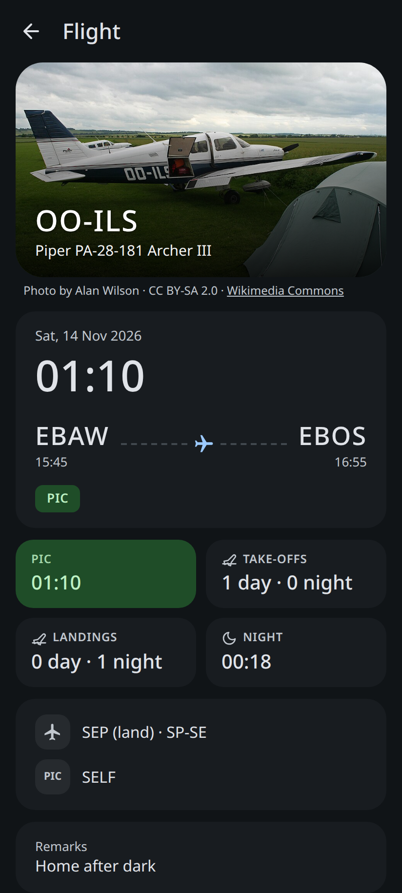 | 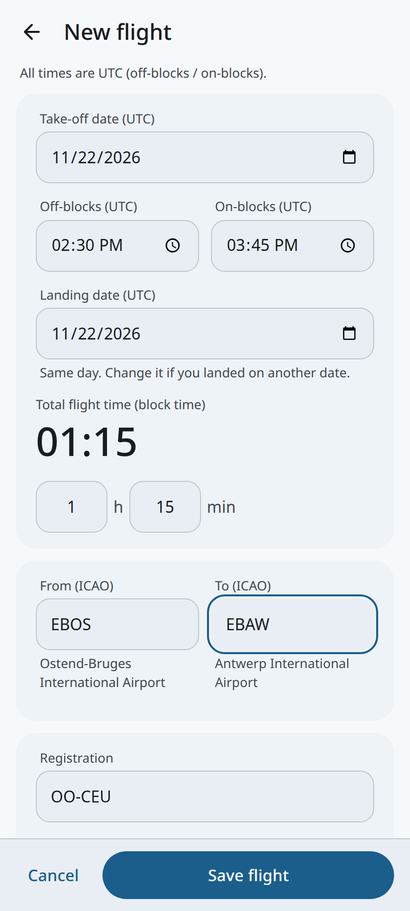 |
| **Totals** | **Currency** | **Map** |
| 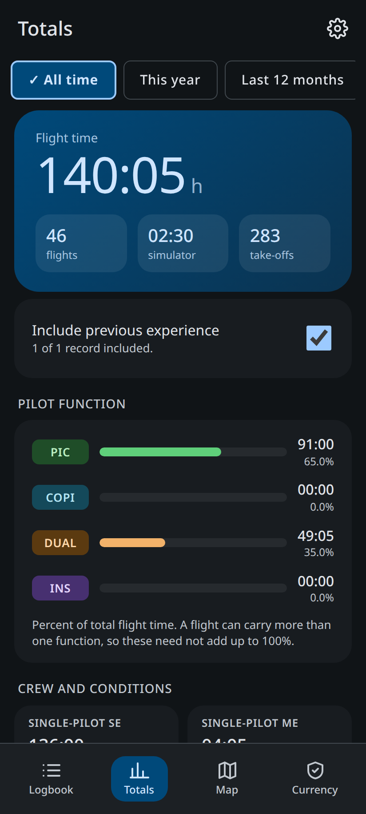 | 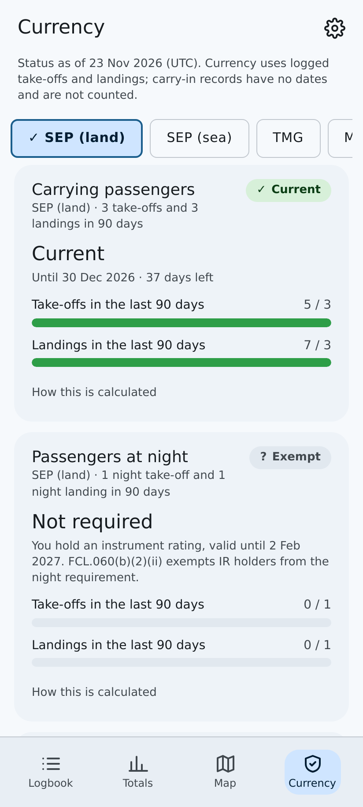 | 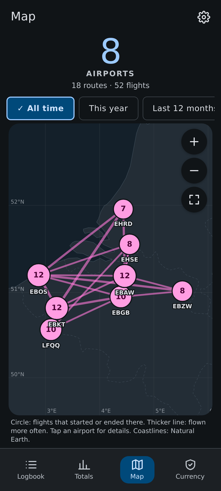 |
| **Class rating revalidation** | **Your licence** | **Alerts** |
| 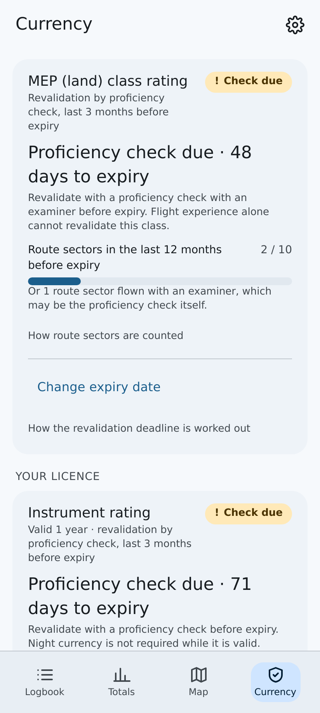 | 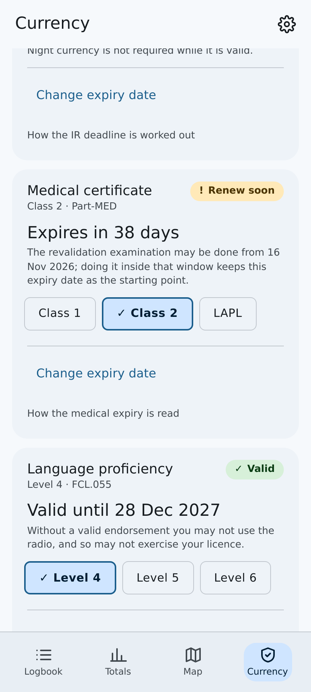 | 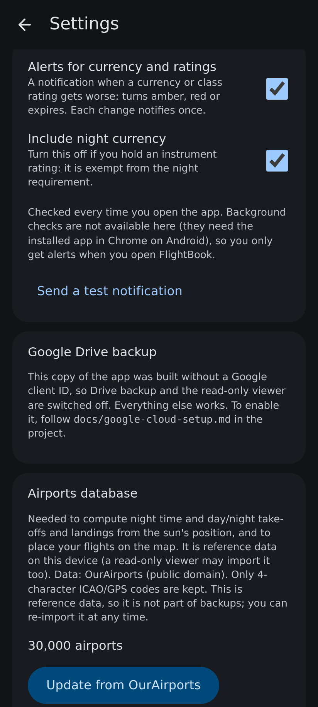 |
| **Holder details for the PDF** | | |
| 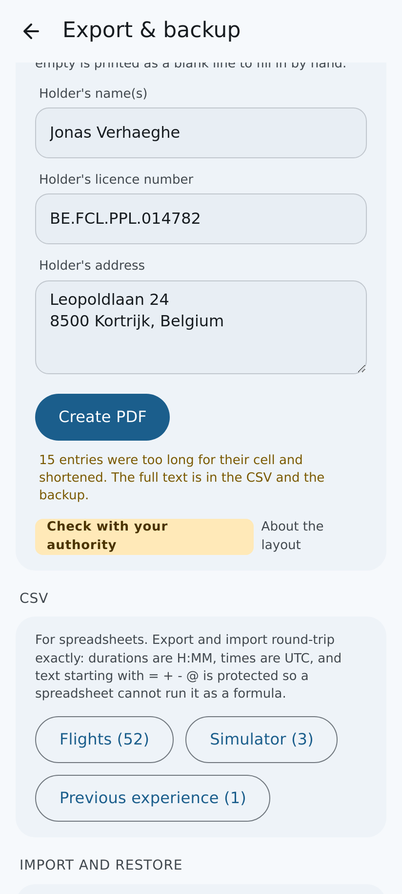 | | |

The PDF logbook: A4 landscape, the holder block and all twelve AMC1 FCL.050 column groups, with simulator sessions in the same table as column 11 (two of them on this page, filling only the FSTD SESSION columns), per-page totals and totals brought forward from the previous experience.

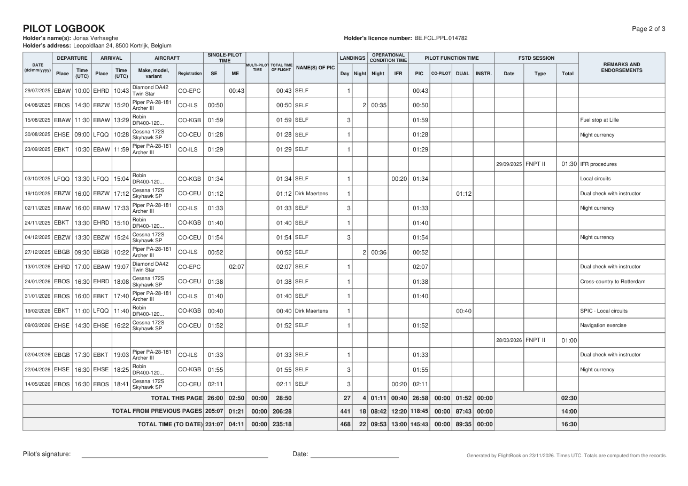

### Regenerating the screenshots
```
npx playwright install chromium                 # once
npx vite-node scripts/make-demo-logbook.ts -- /tmp/demo.json
VITE_BASE=/FlightBook/ npm run build
npx vite preview --port 4330 --strictPort &
curl -sLo /tmp/airports.csv https://davidmegginson.github.io/ourairports-data/airports.csv
node scripts/make-screenshots.mjs http://localhost:4330/FlightBook/ /tmp/demo.json /tmp/airports.csv
```
The script loads the demo logbook through the app's own import and imports the airport database the same way, so the screenshots can only show states the app can really reach: the airport names on the flight form and the routes on the map are looked up, not drawn in. It also saves the PDF the app generates; `pdf-logbook.png` is a page of that file rendered to an image. The `airports.csv` argument is optional; without it the map and the airport names are skipped.

**Planespotters is blocked for the whole run**, so aircraft photos can only come from Wikimedia Commons, and the run aborts if a photo from anywhere else was used. This is a licensing rule, not a preference: Commons photos are freely licensed and can be credited, Planespotters photos are not and must never be committed under `docs/`. The run prints the author and licence of every photo it actually used, read from the app's own cache, so the credits below are written from what was really shown.

### Photo credits
Three third-party photos appear in the screenshots: all three in `docs/screenshots/logbook.png`, and the Cessna again in `docs/screenshots/flight.png`. The app looked each one up on Wikimedia Commons by registration and displays the author and licence itself, as you can see in the Flight screenshot. In the screenshots they are cropped and scaled to fit the app's cards, and shown inside the app's screen.

| Photo | Author | Licence | Source |
|---|---|---|---|
| "Keiheuvel Cessna 172S Skyhawk OO-CEU 02" | Ad Meskens | [CC BY-SA 4.0](https://creativecommons.org/licenses/by-sa/4.0) | [Wikimedia Commons](https://commons.wikimedia.org/wiki/File:Keiheuvel_Cessna_172S_Skyhawk_OO-CEU_02.JPG) |
| "Keiheuvel Robin DR400 120 Dauphin OO-KGB 02" | Ad Meskens | [CC BY-SA 4.0](https://creativecommons.org/licenses/by-sa/4.0) | [Wikimedia Commons](https://commons.wikimedia.org/wiki/File:Keiheuvel_Robin_DR400_120_Dauphin_OO-KGB_02.JPG) |
| "Piper PA28-181 'OO-ILS'" | Alan Wilson | [CC BY-SA 2.0](https://creativecommons.org/licenses/by-sa/2.0) | [Wikimedia Commons](https://commons.wikimedia.org/wiki/File:Piper_PA28-181_OO-ILS_(8439360388).jpg) |

Because those two screenshots contain the photos in changed form, **`docs/screenshots/logbook.png` and `docs/screenshots/flight.png` are shared under [CC BY-SA 4.0](https://creativecommons.org/licenses/by-sa/4.0)**. This applies to those two image files only, not to the FlightBook code or to the other screenshots, none of which contain a third-party photo.

`flight.png` holds only the Cessna, which is already CC BY-SA 4.0. `logbook.png` also holds the Archer, which is CC BY-SA 2.0, and 4.0 is the one licence that covers the mixture: [CC BY-SA 2.0 §4(b)](https://creativecommons.org/licenses/by-sa/2.0/legalcode) lets a derivative work be distributed under "a later version of this License with the same License Elements", and CC BY-SA 4.0 is exactly that (Attribution, ShareAlike).

## Setup
Node 20 or newer (Vite 8 and TypeScript 7; CI uses Node 20).
```
npm install
npm run dev          # http://localhost:5173
npm test             # Vitest unit tests
npm run typecheck
npm run build        # type-check + production build into dist/
npm run preview      # serve dist/ locally (service worker active)
```
Copy `.env.example` to `.env.local` to override `VITE_BASE` (default `/`) or set `VITE_GOOGLE_CLIENT_ID` (Google Drive backup).

## Deploy to GitHub Pages
1. Push to a GitHub repo, then Settings → Pages → Source: **GitHub Actions**.
2. `.github/workflows/deploy.yml` builds with `VITE_BASE=/<repo-name>/` and publishes `dist/` on every push to `main`.
3. The app uses hash routing (`#/flight/…`), so no rewrite rules are needed.
4. For Google Drive, add `https://<user>.github.io` (origins carry no path) to the OAuth client's authorised JavaScript origins, and set the repository variable `VITE_GOOGLE_CLIENT_ID`. The workflow runs the unit tests before every deploy.

## Logging a flight
- **All times are UTC** (off-blocks / on-blocks). The take-off date is the date column of the logbook. The **landing date** follows automatically: the same day, or the next day when the on-blocks time is earlier than off-blocks (the flight crossed midnight UTC). It can be set by hand for anything else (a flight over 24 h gets a warning; a landing before take-off is refused). Saved flights that landed on a later UTC date show **+1** after the landing time.
- **Aircraft are remembered by registration.** Typing a registration you have flown fills in make, model, variant, class and pilot-time category. Each flight keeps its own copy of those details; the remembered ones follow the aircraft's most recent flight, so correcting an old entry never changes what is filled in today. There are no suggestion lists: a new flight starts with the last aircraft, the last pilot in command and "From" set to where the last flight landed.
- **Classes**: SEP (land/sea), TMG, MEP (land/sea), SET (single-engine turbine, land/sea) and Other. Those seven are exactly the aeroplane class ratings in the EASA [Class and Type Rating & Licence Endorsement List](https://www.easa.europa.eu/en/downloads/11737/en) (Part-FCL only refers to class ratings, it never names them); "Other" is for type-rated aeroplanes and anything that is not an aeroplane class rating. A class that contradicts the pilot-time category (an MEP flight logged as single-engine, or a single-engine class logged as multi-engine) gets a warning, never a block.
- **Pilot function**: PIC / COPI / DUAL / INS chips (selected ones are filled and ticked); their time defaults to the total. The chips and +/− counters do not take the focus from a text field, so one tap works while the keyboard is open.

## Install on Android
Open the deployed HTTPS URL in Chrome → ⋮ menu → **Install app** (or "Add to Home screen"). It then starts full-screen and works offline.
On first start choose **This device is the master logbook**; the app then asks the browser for *persistent storage* so Android does not evict your data. Settings shows whether it was granted.

## Data safety
- Data lives in IndexedDB on the device (Dexie). Times are integer minutes / UTC timestamps; totals are never stored.
- Schema changes go through versioned Dexie migrations (see the rules in `src/db/db.ts`). Version 2 (photos) is covered by a test that upgrades a v1 database and checks nothing is lost.
- Deleting a flight asks for confirmation; unsaved form edits ask before being discarded.
- Service-worker updates are never applied automatically; the app shows an "Update" prompt.
- Off-device copies are the Google Drive backups below, or a JSON backup file from Export. Until Drive is connected, **the phone holds the only copy**: don't clear site data.

## Google Drive backup and the read-only viewer
Setup: [docs/google-cloud-setup.md](docs/google-cloud-setup.md) (consent screen in Testing mode, you as test user, every hosting origin as an authorised JavaScript origin). The client ID goes in `VITE_GOOGLE_CLIENT_ID`.
- **Device roles are explicit** (Settings → "This device is the master logbook"), never inferred from screen size. Only the master can edit, and only the master writes to Drive. A viewer is built with a read-only Drive client that has no write operations at all.
- **One master only.** The master keeps `master.json` (device id, name, claim time) in the "Logbook backups" folder. Taking the role from another device shows who holds it and requires explicit confirmation. If Drive holds a *newer snapshot from another device*, the dialog recommends restoring it first, because taking over with older data would make the older data the newest backup. Before every backup the master re-reads `master.json`; if another device has taken over, nothing is written and a banner offers "Take over again" or "Make this device a viewer".
- **Backups** are timestamped JSON snapshots carrying the schema version (`flightbook-snapshot-YYYYMMDDTHHMMSSZ.json`); the latest 30 are kept and only files with that exact naming are ever deleted. They run on app open (if the last success is over 24 h old), about 20 s after you save changes (a burst of edits makes one backup), when the connection returns, and from "Backup now". The last successful time is shown in Settings. If Google needs a sign-in that cannot be silent, a banner offers "Sign in and back up".
- **Restore** (master): pick a snapshot, see exactly what would be added, changed and removed, then either replace everything or only add what is missing. Replacing first saves a copy of what is on the device to Drive (`flightbook-prerestore-…`, last 5 kept) and is one all-or-nothing transaction. Those safety copies are listed in the same dialog under **Undo a restore**, so a mistaken restore can be reversed from inside the app.
- **Viewer**: loads the newest snapshot, runs schema migrations in memory, and shows the list, totals, currency and PDF/CSV export with all editing hidden. A banner reads "Read-only — snapshot from <time>, <device>" with Refresh. The last downloaded snapshot is cached on the device so it opens instantly and offline. The viewer never writes to Drive or changes a snapshot.
- **Limits**: access tokens last about an hour and the pop-up that renews them needs a tap (see the guide); in Testing mode Google may ask you to approve again about weekly. This was verified against a fake Google and Drive in two browsers plus a third device; the first real run with your client ID is the part only you can do.

## Export, import and backup (Settings → Export, import & backup)
- **PDF logbook**: A4 landscape, the full AMC1 FCL.050 structure — the holder block, all twelve numbered column groups in one table with flights and simulator sessions interleaved by date, per-page totals, totals brought forward (page 1 starts from your previous experience), to-date totals, and a signature/date line. The layout is a pure specification (`src/domain/pdfLayout.ts`: columns, widths, pagination, totals) that the renderer (`src/features/export/pdfRender.ts`) only draws; its printed totals are tested against the Totals screen. Characters the built-in PDF font cannot show are replaced (accents dropped, `Ł`→`L`, otherwise `?`) and cut-off text is shortened; both are counted and reported after creation, and the full text stays in the CSV/JSON. pdf-lib is loaded only when a PDF is created.
  - **Checked against AMC1 FCL.050 "Pilot logbook"** (ED Decision 2025/022/R, in the [Easy Access Rules for Aircrew](https://www.easa.europa.eu/en/document-library/easy-access-rules/online-publications/easy-access-rules-aircrew), October 2026 revision). All twelve numbered column groups and their order match, as do the three totals rows (TOTAL THIS PAGE / TOTAL FROM PREVIOUS PAGES / TOTAL TIME); PICUS/SPIC go in the remarks and take-offs are not printed because the AMC has no column for either.
  - **Simulator sessions share the flight table**, as column 11 (FSTD SESSION: date, type, total time of session), which is where the AMC puts them. A session is a row that fills only that group and the remarks, so sessions and flights read as one chronological sequence and session time is totalled in its own column — it can never leak into TOTAL TIME OF FLIGHT.
  - **The holder block** (holder's name(s), licence number, address) is filled in on the Export screen and printed on every page, rather than once on an inside cover, so a loose sheet still identifies its holder. A field you leave empty prints as a blank rule to complete by hand.
  - Fitting all of that on A4 landscape leaves 106 pt for remarks, so text is shrunk, wrapped and finally cut with an ellipsis — and every cut is counted and reported after the PDF is made, with the full text kept in the CSV and JSON exports. `NAME(S) OF PIC` is sized so that even a long surname wraps instead of being cut, since it is a required column; there is a test for it.
  - `TODO(verify)`: FCL.050 only requires the record to be kept "in a form and manner established by the competent authority", and this AMC is one acceptable means rather than the only one — check what your own authority requires before treating the printout as your logbook of record. The AMC header reads `DATE (dd/mm/yy)` where this prints 4-digit years, deliberately.
- **CSV** (flights, simulator sessions, previous experience; one file each): spreadsheet-friendly and **round-trip exact** (tested with hostile text). Durations are `H:MM`, times are UTC ISO 8601, booleans `yes`/`no`, overrides `;`-separated. Text beginning with `= + - @` is written with a leading apostrophe so a spreadsheet cannot execute it, and the apostrophe is removed again on import. Import accepts files from elsewhere too (required columns: `date, dep_place, dep_time_utc, arr_place, arr_time_utc, registration, make, model, class, total, pic_name`); missing ids and timestamps are generated, a missing single/multi-pilot split is taken as single-pilot SE, and unused columns are listed, never silently dropped. Attachments cannot be held by CSV.
- **JSON backup**: the holder's details (name, licence number, address) and everything in the logbook, plus a schema version (`SNAPSHOT_SCHEMA_VERSION`, with an in-memory migration chain used by restore and by the read-only viewer). It excludes the airports database, the photo cache and device settings (device name, master role, theme). A backup from a newer app version is refused, not guessed at.
- **Import and restore never overwrite silently.** Every record is classified before anything is written: *new*, *already there* (identical), *duplicate* (same flight under another id, or repeated in the file: skipped) or *conflict* (same id, different content: you choose to keep yours, the default, or replace). Invalid rows are listed with their line number and why; they block the import until you agree to skip them. The whole import is one transaction: if anything fails, nothing is written. Aircraft and people are matched by registration and name (ids are not carried across devices); restored settings only fill in values that are still empty.

## Map (bottom bar → Map)
Airports are circles with the number of flights that started or ended there (a local flight counts once); lines are the great-circle routes between airports, in either direction, thicker when flown more often. Airports and routes come in six colours (Settings → Map colours: blue, aviation magenta, amber, crimson, ink, teal), each with a light and a dark variant; a unit test checks every option stays readable against land, sea and the number inside the circle. Tap an airport for its name and connections (the map moves it clear of the details card); drag, pinch or scroll to move and zoom; "show all" re-frames everything. A date range (all time, this year, 12 months, 90 days) filters it. Flights whose airport is not in the airports database cannot be drawn as routes; they are listed, and any airport that is known is still counted.
- **Built-in basemap, always on**: muted land and water with coastlines and country borders only (no roads, towns or labels), so the airports and routes stand out; it follows light/dark mode. Data is Natural Earth 1:50m (public domain), simplified by `scripts/make-basemap.mjs` into `src/features/map/basemap.json` (about 150 KB compressed) and drawn by the app, so the map works offline and makes **no third-party requests**. To rebuild it: `node scripts/make-basemap.mjs countries-50m.json` (source: the `world-atlas` package). Coastlines are accurate to a few kilometres, which is right for context but not for navigation.
- Why not map tiles: the clean tile styles (e.g. CARTO Positron) now need an account and API key, and the keyless ones (OpenStreetMap's standard tiles) are the busy, detailed style. The built-in basemap avoids both, and sends nothing anywhere.
- Drawn with Web Mercator (`src/domain/mapProjection.ts`, `mapData.ts`). The airports come from the OurAirports database (Settings), which a read-only viewer may import too since it is reference data. The map code and its data load only when the Map tab is first opened (and are precached for offline use).

## Totals and currency
- **Totals** (bottom bar → Totals): flight time, simulator time, role breakdown (PIC / COPI / DUAL / INS with percentages of total flight time), single-pilot SE/ME, multi-pilot, PICUS, SPIC, night, IFR, take-offs and landings day/night, and per class. Date ranges: all time, this year, last 12 months, last 90 days, or custom. Everything is computed from the records; nothing is stored.
- **Simulator sessions** and **previous experience** (carry-in) are entered from the Totals screen. Previous experience is a list of records (one per paper logbook volume or period) with every category and optional per-class figures. A record is a lump sum, so a date range that cuts through its period leaves it out (the screen says so).
- **Currency** (bottom bar → Currency), per aircraft class, with progress bars and a green / amber / red status (never colour alone: an icon and a word too). Currency counts dated flights only.
  - **Carrying passengers**: 3 take-offs and 3 landings in the last 90 days.
  - **Passengers at night**: 1 night take-off and 1 night landing in the last 90 days &mdash; unless you hold an instrument rating, which removes the requirement (FCL.060(b)(2)(ii)); see below.
  - **Class rating revalidation**, driven by the expiry date you enter per class:
    - *by experience* for SEP (land), SEP (sea) and TMG — 12 h in the class in the 12 months before expiry, of which 6 h as PIC, plus 12 take-offs, 12 landings and an hour of refresher training with an instructor;
    - *by proficiency check* for MEP (land/sea) and SET (land/sea) — there is no experience route for these, so the card tracks the 3-month check window instead, and for MEP also the 10 route sectors;
    - once a rating has expired the card stops counting experience and lists the **renewal** steps instead (assessment, refresher training if deemed necessary, proficiency check).
  - **Your licence** &mdash; a separate section, because none of these are class ratings: they are held once and apply whatever you are flying.
  - **Instrument rating**, tracked by its own expiry date: valid 1 year, revalidated by a proficiency check in the 3 months before expiry (FCL.625). It is not a class rating, so it has its own card outside the class chips.
    - While it is valid, the **night card says "Exempt &mdash; not required"** instead of showing you as lapsed, and night alerts stop. The day it expires, night currency comes back by itself.
    - Stored as a date, not a tick-box, deliberately: a tick-box would keep claiming the exemption after the rating lapsed, which is the dangerous way to be wrong.
    - The app takes the strict reading of "holds an IR" (valid, not merely once held). Being told you are not current when you are is harmless; the reverse is not.
    - Its **renewal** steps are its own, not the class-rating ones: an expired IR must be assessed at an ATO or an approved EBT operator, where a lapsed SEP or TMG may go to a DTO or even an instructor (FCL.625(c) against FCL.740(b)). There is a test that keeps the two lists from drifting together.
  - **Medical certificate** (MED.A.045 &mdash; Part-MED, the one rule here that is not Part-FCL, because the medical grounds you whatever your ratings say). You enter the class and the expiry date printed on it; the card shows the 45-day window in which the revalidation examination may be done, and warns that doing it outside that window restarts the validity period from the examination instead.
    - The app **does not compute the validity period** and does not ask your date of birth. The periods depend on class and age (class 2 is 60/24/12 months by age band), and the bands have edges &mdash; a certificate issued before you turn 40 stops being valid at 42 &mdash; that cannot be got right without data the app has no business holding. The printed date already accounts for all of it.
    - Stored as **a class and a date, nothing else**. Conditions, limitations and findings would be health data under Article 9 GDPR; there is deliberately nowhere to put them, and a test fails if such a field ever appears.
  - **Language proficiency endorsement** (FCL.055): level 4 is re-evaluated every 4 years, level 5 every 6, and level 6 never &mdash; so a level 6 endorsement reports "no re-evaluation needed" rather than pretending to a date. Without a valid endorsement you may not use the radio, and so may not exercise the licence at all, which is why it is watched as closely as the medical.
- **Every regulatory number lives in `src/domain/rules.ts`**, each with the point it comes from, so a correction is a one-line change. They were checked word by word on 23 November 2026 against FCL.060, FCL.740 and FCL.740.A in the **[EASA Easy Access Rules for Aircrew](https://www.easa.europa.eu/en/document-library/easy-access-rules/online-publications/easy-access-rules-aircrew)** (Regulation (EU) No 1178/2011, revision from October 2026, carrying the amendments of Regulation (EU) 2024/2076). Cards whose rule is not verified show an "Unverified rule" label; none of the currency rules do any more.
  - Check against EASA's own text, not a national library: the **UK CAA**'s retained FCL.740.A(b)(1)(ii) lets the 12 hours be spread over the whole validity period as long as 6 fall in the last 12 months, so the SEP figures here are wrong for a UK licence.
  - What the app still cannot know is listed on each card under "How this is calculated" and in the `todo` of each rule: the logbook records no "pilot flying" flag (so every logged take-off and landing is counted), simulator take-offs and landings are never counted although the rule allows them, DUAL time stands in for the refresher flight with an FI or CRI, an instrument rating exempts you from the night requirement but the app does not track ratings, and previous-experience carry-ins have no dates so they never count.
- Not modelled: type ratings (the "Other" class has no expiry tracking), instructor and examiner certificates (FCL.940, FCL.1025 &mdash; 3 years each), the mountain rating (FCL.815) and towing privileges (FCL.805); the BIR (FCL.835), the IR(H)/IR(As) variants, and the FCL.625(d) rule that an IR unused for 7 years needs the theory exam and skill test again &mdash; the app does not know your rating history. Each is noted on the card it would belong to.
- Day-count boundaries are conservative (an event counts on its own day and the 89 days after). The amber and "urgent" thresholds — 14 days before a rolling currency lapses, 60 days for unmet revalidation experience, 30 days for an outstanding proficiency check — are app choices, not regulation.

## Alerts (Settings → Alerts for currency and ratings)
An optional notification when something gets **worse**: a currency or class rating turning amber, turning red, or expiring. Off by default, and device-local — it is never backed up or copied to another device.
- Only the **master** device can run it, because only the master holds the logbook. The switch is disabled on a viewer and says why.
- Turning it on asks the browser for notification permission and then **seeds** today's levels without notifying, so switching it on never floods you with things you can already see on the Currency screen.
- Each change notifies **once**: the levels last seen are stored in settings (`alertState`) and only a step for the worse fires. An improvement is remembered too, so a later worsening notifies again. The level is stored *before* the notification is shown, so a blocked notification cannot make the same alert fire on every check.
- Checked when you open the app and when it comes back to the front. Where the browser supports **periodic background sync** (Chrome on Android, app installed) it is also checked about once a day in the background, from the service worker; Settings says which of the two you are getting.
- Night currency can be left out, for a pilot holding an instrument rating (FCL.060(b)(2)(ii) exempts them).
- There is a "Send a test notification" button. It needs a registered service worker, so it does nothing under `npm run dev` — use `npm run build && npm run preview`.

## Privacy policy and GDPR
[`public/privacy.html`](public/privacy.html) is a plain static page, published at **`https://<user>.github.io/<repo>/privacy.html`**. Google's OAuth verification points at that URL, so it has to stay reachable: it is deliberately a file in `public/` (copied to the root of `dist/`, needs no JavaScript), it is linked from Settings, it is precached so it also opens offline, and the service worker's navigation fallback explicitly excludes it so the single-page app never swallows the request.

It carries the Article 13 disclosures: what is stored on the device, the one Google scope, every outside service with what it receives and how to avoid it, international transfers, legal basis, the data-subject rights (which you exercise in the app itself, since nothing reaches a server), and the right to complain to a supervisory authority. Two points worth knowing as the developer:
- **No cookie banner is needed.** The app sets no cookies and stores nothing for analytics or profiling; IndexedDB is strictly necessary for an offline logbook, which is the ePrivacy exemption.
- **The logbook holds other people's names** (pilots in command, instructors). The policy explains that this is normally covered by the household exemption, Article 2(2)(c) GDPR, but that a pilot keeping the logbook professionally may have their own obligations.

`src/pwa/privacyPolicy.test.ts` keeps the page honest: it fails if the policy stops being reachable, if the app requests a Google scope the page does not name, **if the code gains an outside host the page does not disclose**, if a GDPR section goes missing, or if a push service appears. Update the page before shipping any change to what the app contacts.

## Airports and night time
1. **Settings → Airports database** (any device, since it is reference data): download the public OurAirports `airports.csv` (about 13 MB) or choose a file you downloaded yourself. About 44,000 airports with a 4-character ICAO/GPS code are kept; closed airports and fields without a code are skipped and counted. Import only adds and updates, and a bad file is rejected before anything is written. The data is reference data: not part of backups, re-importable any time.
2. **Night time** = the part of the block time during which the sun's centre is more than 6° below the horizon (end of evening to start of morning civil twilight). The position moves along the great circle from the departure to the arrival airport at constant speed over the block time; each whole minute is classified by the sun's altitude at its midpoint. The result is an integer, never exceeds the block time, and adjacent flights add up exactly.
3. **Take-offs and landings** are marked day or night from the time and place at each end (off-blocks at the departure airport, on-blocks at the arrival airport). The calculation assumes one take-off and one landing; change the counts for circuits. Near twilight the real take-off/landing differs from the block times by a few minutes, so check borderline cases.
4. **Overrides**: any value you change by hand is kept, flagged "Overridden" (shown on the form and in the flight detail), and never replaced by a later recalculation; "Use computed" restores it. Opening an existing flight **never rewrites stored values**: values that differ from the computed ones are kept and marked as overridden.
5. If an airport is not in the database (or you have not imported it yet), enter night time and counts by hand.

**Sun position**: the app computes the sun's *geometric* altitude itself (Meeus, as in the NOAA solar calculator, `src/domain/sun.ts`). The `suncalc` library is not used at runtime: its `getPosition()` returns *apparent* altitude (refraction added, about 0.48° at every below-horizon angle), so testing it against -6° would make every twilight boundary about three minutes late. It is a dev-only dependency used by the tests as an independent cross-check (its `getTimes().dusk/dawn` agree with this code to within seconds).
The definition matches the regulation: Part-FCL **FCL.010** defines night as the period between the end of evening civil twilight and the beginning of morning civil twilight, and civil twilight is bounded by the centre of the sun's disc 6° below the horizon (definitions in the Annex to Regulation (EU) No 923/2012, SERA). `TODO(verify)`: FCL.010 ends "or such other period between sunset and sunrise as may be prescribed by the appropriate authority", so confirm with the authority that issued your licence that it has not prescribed something else; see `src/domain/night.ts`.

## Aircraft photos
Photos are decoration only, and the app stores no image data. Each aircraft shows:
1. **An online photo**, if *Settings → Look up aircraft photos online* is on (default): **Planespotters.net** first (the public API that flight-tracking sites embed), then **Wikimedia Commons**. Only the registration is sent (plus your IP address, as with any website). Commons results are accepted only if the file name contains the exact registration, so a wrong aircraft is never shown. The photographer and a link back are displayed. Only the image URL and credit text are cached on the device; the service worker caches the image itself for offline viewing and can drop it at any time.
2. **A generated placeholder**, coloured from the registration, when there is no photo, no network, or the setting is off.

Look-ups are polite to these free services: a list thumbnail is only looked up when its card scrolls near the screen, at most two look-ups run at a time, a found photo is re-checked twice a year and a missing one after two weeks, and a failed look-up is never remembered as "no photo".

There is deliberately no way to upload your own photos. The cache is device-local metadata and is never backed up, so it is not part of the logbook data.
The Planespotters response format was verified against the live API (November 2026) and is documented in `src/features/photos/planespotters.ts`; it sends `access-control-allow-origin: *`, which is what allows the browser to call it. Keep that call in the page: the API rejects non-browser callers whose User-Agent has no contact URL, and a browser cannot set one. If the shape ever changes, the app falls back to Commons, then a placeholder.

## Dependencies (each justified)
| Package | Why |
|---|---|
| react, react-dom | UI |
| dexie | IndexedDB with versioned schema migrations |
| vite, @vitejs/plugin-react, typescript | build tooling, strict TS |
| vite-plugin-pwa | manifest, and bundling `src/sw.ts` into the service worker (`injectManifest`) |
| workbox-precaching, -routing, -strategies, -expiration, -cacheable-response, -core | the caching primitives `src/sw.ts` is built from; direct dependencies now that the worker is hand-written rather than generated |
| pdf-lib | writes the PDF logbook (no native code, works offline; loaded on demand) |
| vitest, fake-indexeddb | unit tests, including database tests without a browser |
| @types/node | types for `vite.config.ts` |
| suncalc (dev only) | independent cross-check of the sun calculation in tests |

No UI library: Material 3 styling is plain CSS tokens in `src/styles.css`.

## Layout
`scripts/make-demo-logbook.ts` writes the seeded demo logbook and `scripts/make-screenshots.mjs` regenerates the README images from it (see [Regenerating the screenshots](#regenerating-the-screenshots)).

`src/domain` pure logic (types, time, roles, form rules, currency and alert levels, suggestions) · `src/db` Dexie schema and repository · `src/features` screens · `src/ui` shared components · `src/pwa` service-worker registration, storage and notification helpers · `src/sw.ts` the service worker itself (offline caching plus the daily alert check; hand-written, because the alert check has to run inside it) · `public/privacy.html` the published privacy policy · `scripts/make-icons.mjs` regenerates the PNG icons.
